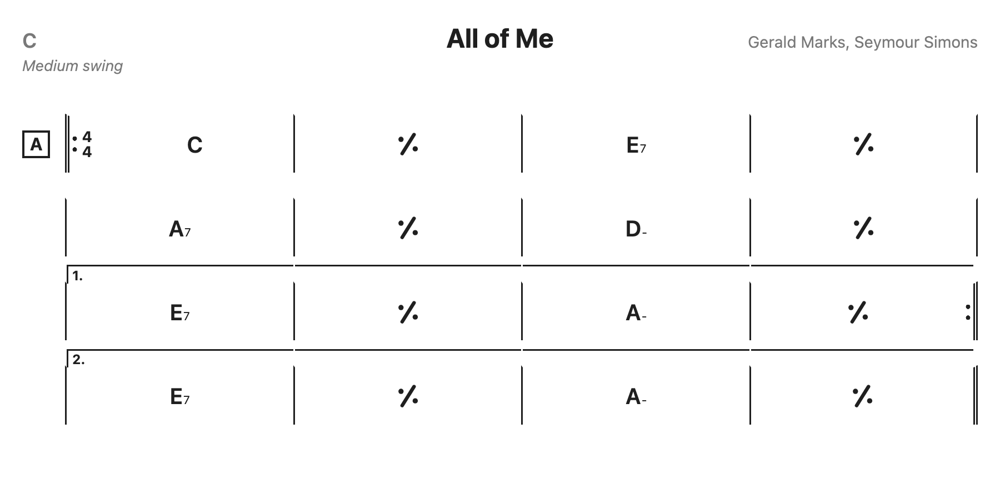
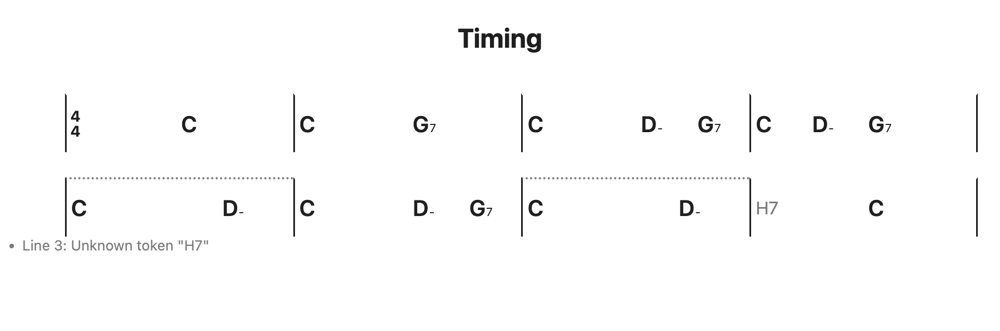
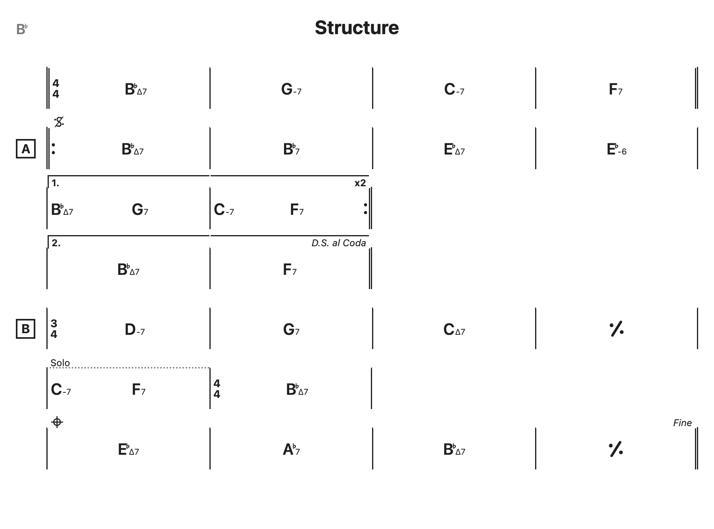

# Cool Chord Sheets

Plain text chord charts rendered in the iReal Pro style, as an Obsidian plugin and as a standalone script for any web page.



Write this in a note or a web page:

````
```chordsheet
title: All of Me
author: Gerald Marks, Seymour Simons
key: C
time: 4/4
notes: Medium swing

[A]
||: C | % | E7 | % |
| A7 | % | D- | % |
| [1.] E7 | % | A- | % :||
| [2.] E7 | % | A- | % ||
```
````

## Installation

### Obsidian community plugins

Once the plugin is listed: Settings, Community plugins, Browse, search for "Cool Chord Sheets", Install, Enable.

### BRAT

Until it is listed, install the [BRAT](https://github.com/TfTHacker/obsidian42-brat) plugin, choose "Add a beta plugin" and enter this repository's URL.

### Manual

Download `main.js`, `manifest.json` and `styles.css` from the latest release and copy them into `<your vault>/.obsidian/plugins/coolchordsheets/`. Reload Obsidian and enable the plugin under Community plugins.

## Quick start

Put a fenced code block with the language `chordsheet` in any note. It renders in reading mode and in live preview once the cursor leaves the block. Parse problems are listed under the chart and never hide it.

## Grammar reference

### Header

Optional `key: value` lines before the first line of bars.

| Key | Meaning |
|---|---|
| `title` | Shown above the chart |
| `key` | A root with optional accidental and minor spelling: `Bb`, `G-`, `Gm`. Shown left of the title |
| `time` | Initial time signature, default `4/4` |
| `author` | Shown right of the title |
| `notes` | Shown under the title in italics. Repeat the key for several lines |

Other keys are kept but not displayed. Blank lines are ignored. Lines starting with `//` are comments.

### Bar lines

Every line of bars starts and ends with a bar line.

| Written | Meaning |
|---|---|
| `\|` | Bar line |
| `\|\|` | Double bar |
| `\|\|:` or `\|:` | Opening repeat |
| `:\|\|` or `:\|` | Closing repeat |
| `:\|\|:` | Close and reopen |
| `:\|\|x3` or `:\|\| x3` | Closing repeat with a count |

A line ending in `||:` opens a repeat on the next line, and a line ending in `:||:` closes the repeat and opens a new one on the next line. A bar containing only `%` repeats the previous bar.

### Timing inside a bar

Chords divide the bar evenly. A run of three spaces or a tab is a hold that gives the previous chord one more slot. `_` is also a hold, for editors that collapse spaces.

| Bar | Slots | Result |
|---|---|---|
| `\| C \|` | C | C for the whole bar, centered |
| `\| C G7 \|` | C, G7 | two half notes |
| `\| C   D- G7 \|` | C, hold, D-, G7 | C half note, D- and G7 quarters |
| `\| C D- G7    \|` | C, D-, G7, hold | three quarters, G7 held through beat 4 |



A bar whose slot count does not fit the time signature gets a dotted top edge. It is a hint, not an error. `N.C.` takes a slot like a chord. Anything the parser does not understand is shown as written, takes a slot, and is listed as a warning under the chart.

### Time signature

`3/4` at the start of a bar changes the time signature from that bar on and draws it in the bar. Denominators 1, 2, 4, 8 and 16 are accepted.

### Sections and markers

`[A]` alone on a line starts a section and draws a boxed label in the left gutter.

At the start of a bar:

| Marker | Rendering |
|---|---|
| `[1.]`, `[2.]`, `[1.-2.]` | Ending bracket over the bar, extending to the next ending or closing repeat |
| `[coda]`, `[segno]` | Coda and segno signs above the bar |
| `[fine]`, `[D.S. al Coda]`, `[D.S. al Fine]`, `[D.C. al Coda]`, `[D.C. al Fine]` | Italic text right-aligned above the bar |
| `[anything else]` | Plain text above the bar, so `[Solo] C` works |

A reserved marker alone on a line attaches to the first bar of the next line.



### Layout

Each source line is one row. Bars are never re-flowed, and column N has the same width in every row, so charts line up like a lead sheet. Rows with fewer bars align to the first columns.

## Chord symbols

A chord is a root `A` to `G`, an optional `b` or `#`, a quality, extensions and an optional `/bass`. Accidentals right after the root belong to the root, so `Cb9` is C flat with a ninth.

| Written | Rendered as | Also accepted |
|---|---|---|
| `C` | C | `Cmaj`, `CM` |
| `C-7` | C-7 | `Cm7`, `Cmin7` |
| `C^7` | CΔ7 | `Cmaj7`, `CM7`, `CΔ7` |
| `C7` | C7 | |
| `C-^7` | C-Δ7 | `C-maj7`, `CmM7`, `Cminmaj7` |
| `Ch7` | Cø7 | `Cm7b5`, `C-7b5`, `Cø7` |
| `Co7` | Co7 | `Cdim7`, `C°7` |
| `C+` | C+ | `Caug` |
| `C+7` | C+7 | `C7+`, `Caug7`, `C7#5` |
| `Csus4` | Csus4 | `Csus` |
| `C7sus4` | C7sus4 | `C7sus` |
| `Csus2` | Csus2 | `C7sus2` |
| `C7b9` | C7♭9 | `C7(b9)`, alterations `b5 #5 b9 #9 #11 b13` in any row |
| `C6/9` | C6/9 | `C69`, `Cadd9` |
| `C7/E` | C7 over E | bass note with optional accidental |
| `N.C.` | N.C. | `NC`, `N.C` |

Unknown qualities are rendered verbatim and flagged as a warning.

## Settings

| Setting | Default | Range |
|---|---|---|
| Chord font size | 16 px | 10 to 32 |
| Show holds as small dots | off | |
| Mark uneven bars | on | |

Changes apply to open charts immediately.

## Using on a web page

The standalone build is two files with no dependencies. Build them with `npm run build:web` or take them from a release, then:

```html
<link rel="stylesheet" href="coolchordsheets.css">
<pre class="chordsheet">
| C | G7 | C   D- G7 | C D- G7    |
</pre>
<script src="coolchordsheets.js"></script>
```

Every `pre.chordsheet` is replaced by a chart when the page loads. Markdown pipelines that emit `<pre><code class="language-chordsheet">` for a `chordsheet` fence work too. Use `<pre>`: the grammar counts spaces, and any other element collapses them.

Per-element options: `data-show-holds="true"`, `data-show-uneven="false"`, `data-font-size="20"`.

To control rendering yourself, add `data-manual` to the script tag and call the API:

```js
CoolChordSheets.renderAll(document, { showHolds: true });
CoolChordSheets.render(text, container, { fontSize: 20 });
```

The ES module build never renders on its own:

```js
import { render, renderAll } from "./coolchordsheets.esm.js";
```

Try it live on the [demo page](https://estebanmdq.github.io/coolchordsheets/).

## Development

```
npm install
npm run build        # Obsidian plugin: main.js
npm run build:web    # standalone: dist/
npm test
npm run demo         # builds and prepares docs/index.html for local viewing
npm run screenshots  # regenerates docs/img from examples/ (needs Chrome)
```

`npm run dev` rebuilds the plugin on change. Copy `main.js`, `manifest.json` and `styles.css` into `.obsidian/plugins/coolchordsheets/` in a vault to try it. The parser and chord modules have no Obsidian dependency and are tested in Node; the renderer is tested under happy-dom.

## License

[MIT](LICENSE)
